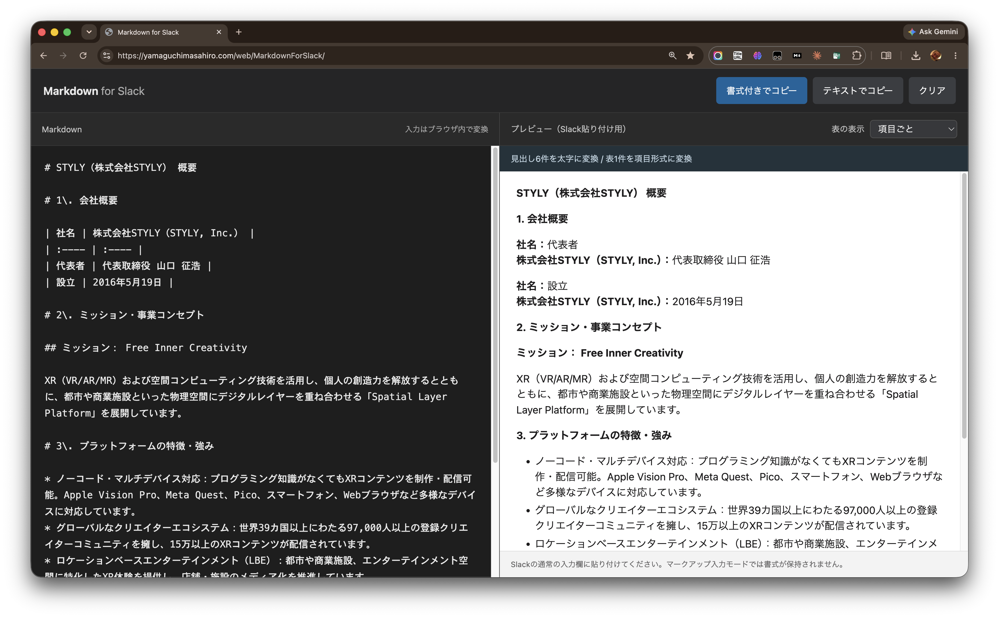

# Markdown for Slack

Convert Markdown into Slack-friendly formatting. Paste your Markdown, preview the result, and copy it into Slack. All conversion happens in your browser.

**Live site:** [https://from2001.github.io/MarkdownForSlack/](https://from2001.github.io/MarkdownForSlack/)

## Deployment

Updates to the `main` branch are automatically published to GitHub Pages by GitHub Actions after the tests pass. No separate server is needed.

For local setup, conversion rules, testing, and deployment configuration, see the [development guide](docs/DEVELOPMENT.md).
